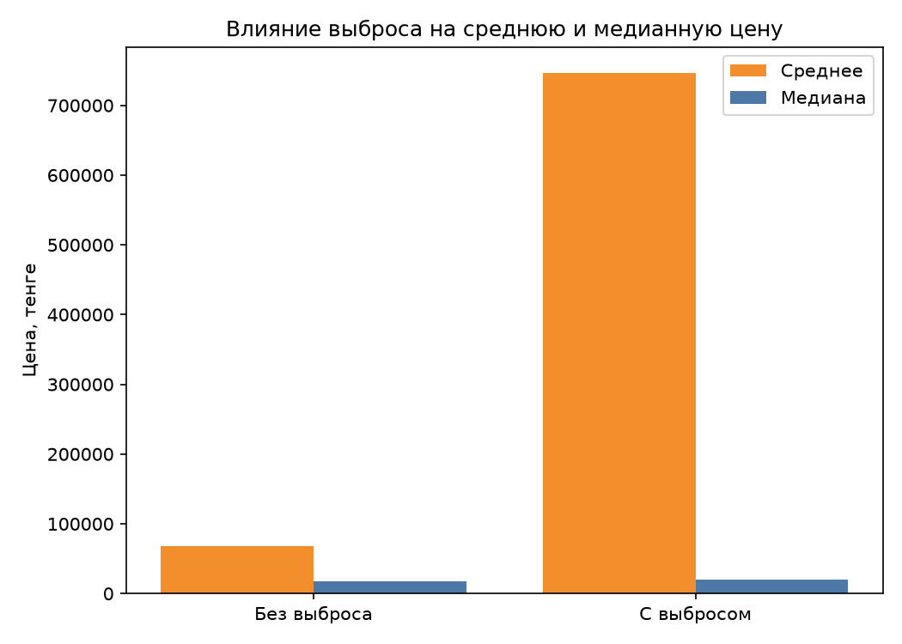
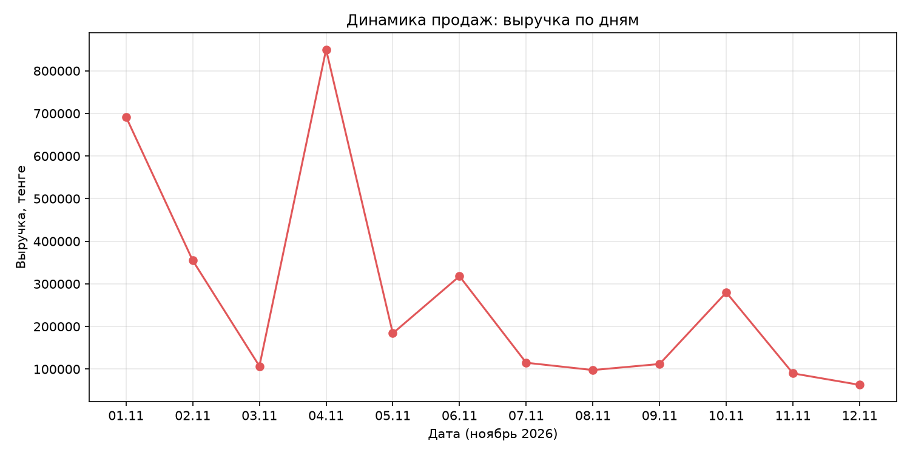
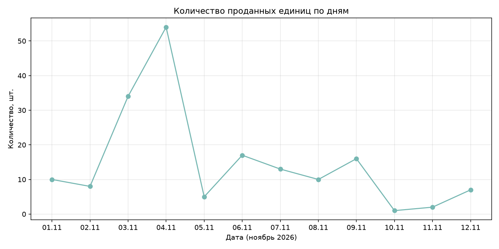

# День 3. Исследование данных и поиск аномалий

Отчёт создаётся автоматически программой `analysis.py` и пересчитывается при изменении данных в `shop.db`.

## 1. Качество данных
| Проверка | Результат |
|----------|-----------|
| Пропуски (всего по всем столбцам) | 0 |
| Повторяющиеся продажи без учёта id | 0 |
| Цена или количество <= 0 | 0 |
| Неверные даты | 0 |

Повторяющиеся продажи автоматически не удаляются: две одинаковые продажи могут быть настоящими, это нужно проверять вручную.

## 2. Среднее и медиана цены
- Средняя цена: **67 671 тенге**
- Медианная цена: **18 000 тенге**

## 3. Анализ выброса
Эксперимент выполнялся на копии базы в памяти (файл `shop.db` не изменялся): добавлена тестовая запись с ценой 15 000 000 тенге.

| Показатель | До | После | Изменение |
|------------|----|-------|-----------|
| Средняя цена | 67 671 | 746 414 | +1003% |
| Медиана цены | 18 000 | 20 500 | +13.9% |
| Общая выручка | 3 263 800 | 18 263 800 | +460% |

### Почему необычные значения искажают результаты
Среднее арифметическое учитывает каждое значение, поэтому одно очень большое число сдвигает его далеко от типичных цен, и по среднему становится невозможно судить, сколько стоит обычный товар. Суммы (выручка) искажаются так же: одна ошибочная запись меняет главный показатель отчёта и все построенные на нём графики и решения. Медиана определяется положением значения в упорядоченном ряду, а не его величиной, поэтому почти не реагирует на выбросы. Поэтому перед анализом необходимо проверять данные и выяснять, ошибка это или реальное редкое событие: ошибку исправляют, реальное значение оставляют, но анализируют отдельно.

## 4. Динамика продаж
- День с максимальной выручкой: **2026-11-04** (850 000 тенге)
- День с минимальной выручкой: **2026-11-12** (63 000 тенге)

## 5. Выводы
1. Пропусков в данных нет, повторяющихся продаж без учёта id: 0, логических ошибок (цена или количество <= 0, неверная дата): 0.
2. Средняя цена (67 671 тенге) выше медианы (18 000 тенге): в данных есть дорогие товары, которые тянут среднее вверх.
3. Одна запись с ценой 15 000 000 тенге увеличила среднюю цену на 1003%, а медиану лишь на 13.9%: медиана устойчива к выбросам.
4. Тот же выброс увеличил общую выручку на 460%, то есть одна ошибка полностью исказила бы главный показатель отчёта.
5. Максимальная выручка за день: 2026-11-04 (850 000 тенге), минимальная: 2026-11-12 (63 000 тенге).
6. Средняя дневная выручка во второй половине периода снизилась (417 667 -> 126 300 тенге), но дни с дорогой техникой резко меняют график, поэтому по такому короткому периоду тренд ненадёжен.
